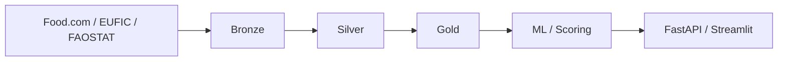

 

# Benoist LÉGAL

**Data Engineering · Architecture des systèmes · IA appliquée**

*Comprendre les systèmes. Structurer les données. Faire évoluer les solutions.*

## À propos

J'évolue à l'intersection de **l'ingénierie des données, de l'architecture applicative et de l'industrialisation des systèmes**.

Mon approche consiste à comprendre les environnements techniques dans leur ensemble : analyser les architectures existantes, identifier les dépendances, cartographier les flux et accompagner l'évolution des solutions en tenant compte des contraintes techniques et des usages métiers.

À travers mes expériences à **l'Institut national de l'audiovisuel (INA)**, j'ai contribué à différents projets Data & IA, de l'analyse des traitements à leur documentation, leur fiabilisation et leur mise en production.

Je m'intéresse autant à la **construction de nouvelles solutions** qu'à la compréhension, à la maintenance et à la modernisation de systèmes existants.

## Expériences & contributions

| Domaine | Contributions |
| :--- | :--- |
| **Architecture applicative** | Analyse d'environnements techniques, cartographie des flux et des dépendances, conception et rédaction de DAT/DDEX sur 4 produits Data & IA. |
| **Data Engineering** | Analyse de pipelines, transformations de données, alimentation de Datamarts, contrôles de cohérence et de complétude. |
| **Qualité & industrialisation** | Automatisation des tests de non-régression, réduction de plus de 50 % du temps de recette et accompagnement du passage de PoC vers la production. |
| **IA & NLP** | Qualification d'entités nommées, rapprochement de référentiels et enrichissement de données d'entraînement pour un modèle BERT à l'aide de *hard negatives*. |
| **Évolution des systèmes** | Analyse des dépendances techniques, préparation de migrations d'infrastructure, documentation et procédures d'exploitation. |

Ces contributions s'inscrivent dans des environnements associant équipes de développement, data engineering, data science, métiers et exploitation.

## Projet personnel — YUMMY

**[Explorer YUMMY →](https://github.com/benstL/yummy-data-platform)**

**YUMMY** est une plateforme expérimentale de recommandation de recettes, construite autour d'une architecture de traitement et de valorisation des données.

Le projet explore l'ensemble d'une chaîne Data : collecte, ingestion, transformation, enrichissement, traitements ML/NLP et exposition des résultats via API et interface utilisateur.

**Architecture fonctionnelle**

**Stack technique**

`Python` · `SQL` · `DuckDB` · `Parquet` · `Airflow` · `dbt` · `MinIO` · `Docker` · `FastAPI` · `Streamlit` · `NLP`

**Axes d'évolution**

- Fiabilisation et orchestration des pipelines
- Observabilité et suivi de la qualité des données
- Amélioration des modèles de scoring
- Expérimentation de nouvelles fonctionnalités IA

## Environnement technique

**Data Engineering & stockage**

`Python` · `SQL` · `ETL/ELT` · `MongoDB` · `DuckDB` · `Parquet` · `Datamarts` · `Medallion`

**Architecture & API**

`FastAPI` · `REST` · `Architecture applicative` · `Cartographie des flux` · `DAT/DDEX`

**Orchestration & industrialisation**

`Airflow` · `Dagster` · `Docker` · `Jenkins` · `GitHub Actions` · `CI/CD` · `Tests automatisés`

**Machine Learning & NLP**

`BERT` · `NER` · `TF-IDF` · `KMeans` · `VADER` · `Clustering` · `Scoring`

---

**Ingénierie des données · Architecture · Évolution des systèmes**

[LinkedIn](https://linkedin.com/in/benoistlegal) · [GitHub](https://github.com/benstL) · [YUMMY](https://github.com/benstL/yummy-data-platform)

