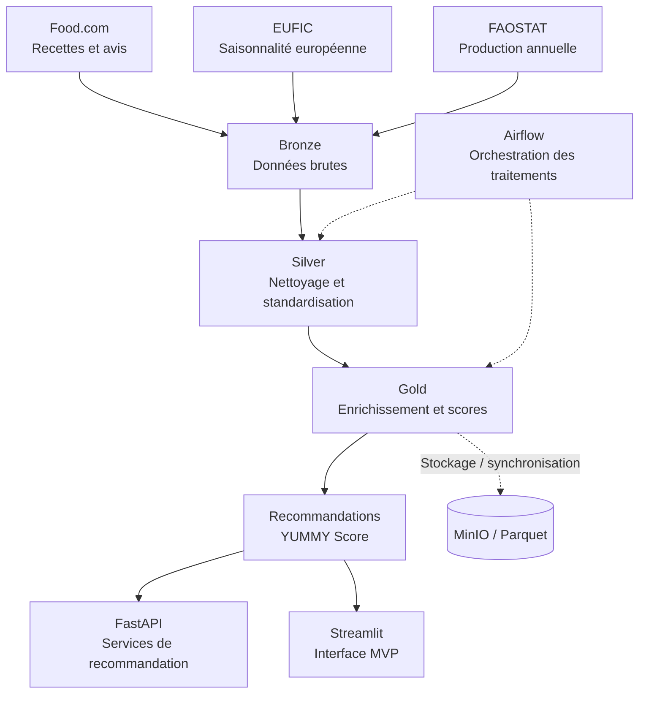

# 👋 Bonjour, je suis Benoist Légal

### Data Engineering · Architecture des données · IA & Analytics

*De la compréhension des besoins à l'industrialisation de solutions data.*

---

## 👨‍💻 À propos

🎓 Diplômé du **Master Ingénierie de la Donnée — Mines Paris – PSL Executive Education × Liora**.

🏗️ **Trois années à l'INA**, à l'interface entre équipes métiers et techniques : architecture applicative, documentation technique, traitements de données et industrialisation de projets.

🔎 J'aime comprendre les systèmes dans leur ensemble : flux, données, contraintes, usages, et même faire de la rétro-ingénierie quand c'est nécessaire.

🌱 Je poursuis ma montée en compétences en **Data Engineering, DataOps, Machine Learning et architectures data**.

> Mon fil conducteur : construire des solutions compréhensibles, maintenables et utiles.

---

## 🍽️ YUMMY — Mon projet Data & IA

**YUMMY** est une plateforme expérimentale de **recommandation de recettes fondée sur les données**. Elle rapproche des recettes et avis utilisateurs, des informations sur la saisonnalité et des indicateurs de disponibilité alimentaire pour proposer des recommandations contextualisées.

L'utilisateur peut explorer des recettes selon son **pays**, le **mois** et les **ingrédients** qui l'intéressent. L'objectif n'est pas seulement de classer les recettes, mais aussi **d'expliquer les critères utilisés** et de signaler les limites des données.

### 🎯 Ce que j'explore avec YUMMY

- **Data Engineering** : ingestion, nettoyage, standardisation et enrichissement des données.
- **Architecture** : séparation Bronze / Silver / Gold et stockage analytique.
- **Data Science** : analyse de sentiment, regroupement de recettes et scoring multicritère.
- **API & produit** : exposition des recommandations et interface de consultation.
- **Qualité & transparence** : distinction entre saisonnalité documentée et disponibilité estimée.

### 🏗️ Architecture conceptuelle

> **Note d'architecture :** le MVP Streamlit peut lire les données Gold locales ; MinIO n'est pas nécessairement interrogé à chaque consultation. Ce schéma présente les principaux composants du projet, pas une infrastructure cloud déjà déployée.

### 🧪 Sources de données

| Source | Rôle dans le projet | Limite à connaître |
|---|---|---|
| **Food.com** | Recettes, ingrédients et avis | Données historiques et qualité variable |
| **EUFIC** | Références de saisonnalité en Europe | Couverture principalement européenne |
| **FAOSTAT** | Indicateurs de production par pays | La production annuelle **ne mesure pas** directement la saisonnalité mensuelle |

### 🧰 Stack du projet

### 🚧 Un projet en évolution continue

**MVP et travaux déjà engagés**

- [x] Collecte et préparation des données de recettes
- [x] Structuration Bronze / Silver / Gold
- [x] Premiers traitements NLP, clustering et scoring
- [x] Première API FastAPI et interface Streamlit
- [x] Expérimentation d'une orchestration Airflow et du stockage MinIO

**Prochaines améliorations**

- [ ] Renforcer les tests automatiques et les contrôles qualité
- [ ] Consolider les modèles dbt et les contrats de données
- [ ] Uniformiser l'exécution avec Docker Compose
- [ ] Ajouter une observabilité plus complète (Prometheus / Grafana)
- [ ] Améliorer l'explicabilité et le niveau de confiance des recommandations
- [ ] Étudier la traduction FR / EN et un déploiement cloud

<strong>🔍 Comment fonctionne le YUMMY Score ?</strong>

Le score expérimental combine plusieurs dimensions : appréciation des recettes, cohérence des ingrédients, temps de préparation et indicateurs de saisonnalité ou de disponibilité. Les pondérations et leur validation restent des axes d'amélioration.

La disponibilité estimée à partir de FAOSTAT ne doit pas être présentée comme une preuve de saisonnalité locale.

<strong>🧭 Pourquoi ce projet ?</strong>

YUMMY est mon terrain d'expérimentation de bout en bout : partir de données hétérogènes, concevoir des transformations reproductibles, construire un produit consultable et documenter honnêtement les limites des indicateurs.

➡️ **Retrouver le projet :** [mes dépôts GitHub](https://github.com/benstL?tab=repositories) — rechercher **YUMMY**.

---

## 🛠️ Technologies & pratiques

| Domaine | Technologies / sujets |
|---|---|
| **Traitement & analyse** | Python, SQL, Pandas, DuckDB, Parquet |
| **Orchestration & DataOps** | Airflow, Dagster, Docker, Jenkins, GitHub Actions |
| **Stockage & modélisation** | MongoDB, MinIO, dbt, architectures Medallion |
| **Applications** | FastAPI, Streamlit, APIs REST |
| **IA & NLP** | Classification, analyse de sentiment, clustering, BERT |
| **Architecture & collaboration** | DAT, schémas de flux, documentation, interfaces métier/technique |

<strong>⚙️ Ce que j'aime approfondir</strong>

- La fiabilité des pipelines : reprise sur erreur, idempotence, qualité et traçabilité.
- Le passage du prototype à un système industrialisable.
- L'observabilité, les tests et les pratiques CI/CD.
- La compréhension des systèmes existants et leur évolution progressive.

---

## 📈 GitHub en un coup d'œil

> Ces cartes proviennent d'un service externe et peuvent être momentanément indisponibles. Elles reflètent l'activité GitHub publique, pas l'ensemble de mon expérience professionnelle.

---

### 🤝 Échangeons

Je suis ouvert aux échanges techniques, aux collaborations et aux opportunités autour de la data et de l'IA.

**Merci de votre visite !**

