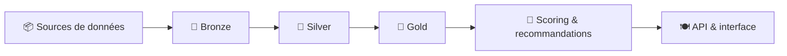

# Bonjour, moi c'est Benoist 👋

### Comprendre l'existant. Construire la suite.

**Data Engineering · Architecture technique · IA appliquée**

*Entre besoins métiers et solutions techniques, j'aime donner du sens aux données — et construire les systèmes qui permettent de les exploiter.*

---

## Ce que j'apporte

Je suis **ingénieur de la donnée**, diplômé du **Master Ingénierie de la Donnée (Mines Paris – PSL Executive Education × Liora)**.

Pendant **trois ans à l'INA**, j'ai évolué à l'interface des équipes métiers et techniques, sur des sujets mêlant **architecture applicative, traitements de données, documentation technique et industrialisation de projets data**.

Ce que j'aime particulièrement : **comprendre un environnement, relier ses composants, identifier les besoins et contribuer à une solution concrète**. Qu'il s'agisse d'un système existant à faire évoluer ou d'un projet à construire, la curiosité technique reste mon point de départ.

> **Mon fil conducteur :** faire le lien entre la donnée, les outils et les personnes qui les utilisent.

## 🧩 Mes terrains de jeu

| Concevoir | Construire | Faire évoluer |
| :--- | :--- | :--- |
| Architectures data, flux, interfaces, documentation technique | Pipelines Python/SQL, traitements NLP, API et applications | Orchestration, automatisation, CI/CD, compréhension et amélioration de l'existant |

**Outils rencontrés et explorés :**

`Python` `SQL` `Pandas` `DuckDB` `Airflow` `Dagster` `Docker` `dbt` `MinIO` `FastAPI` `Streamlit` `MongoDB` `GitHub Actions` `Jenkins`

---

## 🍽️ YUMMY — de la donnée brute à la recommandation

**Mon projet phare · Data Engineering & IA · En évolution continue**

**Et si choisir une recette pouvait aussi tenir compte de la saisonnalité, des ingrédients et des données disponibles ?**

YUMMY explore cette idée à travers une plateforme de recommandation de recettes. C'est aussi mon laboratoire pour travailler **l'ensemble d'une chaîne data** : ingestion, préparation, modélisation, scoring et restitution dans une application.

**Les données :** Food.com (recettes et avis), EUFIC (saisonnalité européenne) et FAOSTAT (production agricole annuelle, utilisée avec prudence comme indicateur complémentaire de disponibilité).

**La démarche :** architecture Medallion, traitements Python et SQL, analyse de sentiment, clustering, score multicritère, API FastAPI et interface Streamlit.

**L'ambition :** améliorer progressivement la qualité des recommandations, la fiabilité des données et l'industrialisation de la plateforme.

<b>🔍 Voir les chantiers d'évolution de YUMMY</b>

 

- Renforcer la qualité, la traçabilité et les indicateurs de confiance des données.
- Faire évoluer les traitements et l'orchestration (Airflow, dbt, MinIO).
- Approfondir l'explicabilité et la pertinence du YUMMY Score.
- Développer les tests, la CI/CD et l'observabilité.
- Améliorer l'expérience utilisateur et explorer de nouveaux usages de l'IA.

*Cette liste présente des axes de travail, pas des fonctionnalités toutes déjà livrées. L'état précis des composants est documenté dans le dépôt.*

**→ [Explorer le code, l'architecture et les prochaines étapes de YUMMY](https://github.com/benstL/yummy-data-platform)**

---

## 🏛️ Une expérience de terrain : l'INA

À l'**Institut national de l'audiovisuel**, j'ai contribué à des projets de valorisation des données audiovisuelles, au croisement des enjeux documentaires, métiers et techniques.

- **Architecture & analyse :** compréhension des systèmes, cartographie des applications et des flux, dossiers d'architecture technique.
- **Data & traitements :** contribution à des environnements de traitement de transcriptions, d'entités nommées et de données de référence.
- **Industrialisation & collaboration :** échanges entre métiers et équipes techniques, formalisation des interfaces et accompagnement de l'évolution des solutions.

*Les réalisations professionnelles sont présentées ici à un niveau général, dans le respect de la confidentialité des projets.*

---

## 🚀 Et maintenant ?

Je souhaite rejoindre une équipe où je pourrai **contribuer à des projets data concrets**, approfondir mes compétences et continuer à naviguer entre **ingénierie, architecture et compréhension métier**.

Je m'intéresse notamment aux opportunités en **Data Engineering, ingénierie d'études et ingénierie transverse**, avec une ouverture aux projets d'IA appliquée.

### Un projet, une idée, une opportunité ?

**Échangeons.**

