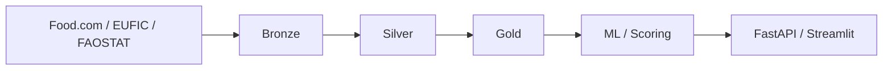

# Benoist LÉGAL

**Data Engineering · Architecture applicative · IA**

*Comprendre les systèmes. Fiabiliser les données. Construire des solutions utiles.*

     

## Ce que j'apporte

Diplômé d'un **Master en Ingénierie de la Donnée (Mines Paris – PSL Executive Education)**, j'ai contribué à des projets **Data & IA à l'INA**, entre ingénierie, architecture et besoins métiers.

J'aime **comprendre l'existant**, relier les enjeux techniques aux usages, puis accompagner la construction de solutions fiables : de la cartographie des flux à l'industrialisation des traitements.

## Réalisations marquantes

| Domaine | Contributions et résultats |
| :--- | :--- |
| **Architecture & industrialisation** | Architecture et documentation de **4 produits Data & IA** ; cartographie des flux, DAT/DDEX, accompagnement du passage de PoC vers la production. |
| **Qualité & automatisation** | Tests de non-régression automatisés : **plus de 50 % de réduction du temps de recette** ; analyse de la cohérence et de la complétude des données. |
| **IA & référentiels** | Qualification de milliers d'entités, rapprochement de personnalités et pipeline Python pour enrichir les données d'entraînement d'un modèle **BERT** avec des *hard negatives*. |

<b>Autres contributions à l'INA</b>

- Préparation d'une migration d'infrastructure : dépendances, procédures et runbook.
- Analyse de pipelines d'alimentation de Datamarts et suivi des anomalies.
- Collaboration avec les équipes data, documentaires, qualité et exploitation.

## 🍽️ YUMMY 

**[Découvrir le dépôt YUMMY →](https://github.com/benstL/yummy-data-platform)** · **MVP fonctionnel, en évolution**

Une plateforme de **recommandation de recettes** fondée sur les données alimentaires, les avis utilisateurs et la saisonnalité. Un projet de bout en bout pour explorer l'ingestion, la transformation, les traitements ML/NLP et la restitution de recommandations explicables.

**Technologies :** Python · SQL · DuckDB · Parquet · Airflow · dbt · MinIO · Docker · FastAPI · Streamlit · NLP

**En évolution :** robustesse des pipelines, observabilité, amélioration du scoring et exploration de nouvelles fonctionnalités IA.

## Compétences

**Data & architecture** — Python, SQL, ETL/ELT, Medallion, Datamarts, MongoDB, DuckDB, Parquet, FastAPI  
**IA & NLP** — BERT, NER, TF-IDF, KMeans, VADER, clustering, scoring  
**Industrialisation** — Airflow, Dagster, Docker, Git, Jenkins, GitHub Actions, CI/CD, tests, DAT/DDEX

Cloud : notions en cours d'approfondissement, sans expertise revendiquée.

---

**Un système à comprendre, des données à valoriser, un projet à faire évoluer ?**  
[Échangeons sur LinkedIn](https://linkedin.com/in/benoistlegal) · [Explorer YUMMY](https://github.com/benstL/yummy-data-platform)

