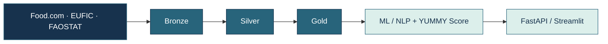

# Benoist LÉGAL

### Data Engineering · Architecture · IA

**Comprendre les systèmes. Fiabiliser les données. Construire des solutions utiles.**

*Paris, France · Ouvert aux opportunités en Data Engineering, architecture data et conseil Data & IA*

---

## 👋 Ce que j'apporte

**Diplômé d'un Master en Ingénierie de la Donnée, avec trois ans d'expérience sur des projets Data & IA à l'Institut national de l'audiovisuel (INA).**

J'interviens à l'interface des équipes métiers et techniques : **comprendre l'existant, cartographier les flux, concevoir les évolutions et accompagner l'industrialisation**. J'aime autant résoudre un problème de qualité de données que comprendre les dépendances d'une application ou construire un pipeline Python.

Aujourd'hui, je souhaite contribuer à des projets de transformation Data & IA et approfondir mon expertise en **Cloud et IA générative**.

## 🔎 Quelques réalisations à l'INA

**Chargé de projets Data · Direction de la Technologie — Ingénierie transverse · 2023–2026**

| Domaine | Contribution |
| :-- | :-- |
| 🏗️ **Architecture** | Architecture et documentation de **4 produits Data & IA** : cartographie applicative, flux, DAT, DDEX et préparation de l'industrialisation. |
| 🔄 **Migration** | Coordination technique d'une migration d'infrastructure : dépendances, préparation de bascule et runbook de reprise. |
| 📊 **Qualité des données** | Analyse des pipelines alimentant les Datamarts de **data.ina.fr** : cohérence, complétude et anomalies. |
| 🔍 **Référentiels** | Accompagnement d'un outil de qualification de personnalités, du PoC à la production, avec rapprochement de plusieurs milliers d'entités. |
| 🧠 **NLP / BERT** | Développement d'un pipeline Python pour enrichir les données d'entraînement avec des **hard negatives** et des cas de désambiguïsation complexes. |
| ✅ **Automatisation** | Tests de non-régression sur les référentiels : **plus de 50 % de temps de recette économisé**. |

> Ces travaux ont été réalisés dans un environnement professionnel ; les systèmes internes et les données de l'INA ne sont pas publiés ici.

---

## 🚀 Projet phare — YUMMY

 

**[→ Voir le dépôt YUMMY et son code source](https://github.com/benstL/yummy-data-platform)**

**Une plateforme de recommandation alimentaire durable, née de mon projet de Master et toujours en évolution.**

L'objectif : rapprocher des **recettes**, des **avis utilisateurs** et des **données de saisonnalité / production agricole** pour proposer des recommandations pertinentes et explicables.

**Ce que j'y construis :** une chaîne de données de bout en bout, de l'ingestion à l'application utilisateur, avec des traitements NLP/ML et un score de recommandation multicritère.

**Stack :** `Python` · `SQL` · `DuckDB` · `Parquet` · `Airflow` · `dbt` · `MinIO` · `Docker` · `FastAPI` · `Streamlit` · `scikit-learn`

### Du prototype à une plateforme évolutive

- **MVP fonctionnel :** préparation et enrichissement des données, recommandations, API FastAPI et interface Streamlit.
- **Architecture et automatisation :** travaux autour d’Airflow, dbt, Docker et MinIO pour rendre les traitements reproductibles et faciliter leur industrialisation.
- **Prochaines évolutions :** observabilité, amélioration de la pertinence et de l’explicabilité du scoring, enrichissement des fonctionnalités IA et déploiement.

Le projet évolue progressivement : les composants explorés ou prévus ne sont pas tous utilisés dans le parcours applicatif en production.

### [→ Découvrir YUMMY sur GitHub](https://github.com/benstL/yummy-data-platform)

<b>🧪 Ce que YUMMY me permet d'expérimenter</b>

- **Data Engineering :** architecture Medallion, ingestion multi-sources, nettoyage, contrôles et modélisation.
- **Orchestration :** automatisation des traitements et reproductibilité des pipelines.
- **ML / NLP :** sentiment, TF-IDF, clustering et score de recommandation.
- **Produit :** API et interface permettant de rendre les résultats accessibles et explicables.
- **Esprit critique :** distinction entre données de saisonnalité fiables et indicateurs de disponibilité estimés.

---

## 🧰 Mon environnement technique

| | Outils & pratiques |
| :-- | :-- |
| **Développement** | Python, SQL, Pandas, NumPy, FastAPI, REST |
| **Data & stockage** | ETL/ELT, Medallion, Data Lake / Lakehouse, DuckDB, MongoDB, Parquet, MinIO/S3, dbt, Datamarts |
| **IA / ML** | NLP, BERT, NER, TF-IDF, KMeans, VADER, clustering, scoring |
| **Orchestration & DevOps** | Airflow, Dagster, Docker, Jenkins, GitHub Actions, Helm, CI/CD |
| **Architecture & qualité** | DAT, DDEX, cartographie des flux, TNR, JMeter, runbooks, documentation d'exploitation |

## 🎓 Parcours

- **2024–2026** · Master 2 Ingénierie de la Donnée — **Mines Paris – PSL Executive Education**
- **2023–2024** · Licence professionnelle Data Analytics — **Ironhack Paris** (formation en anglais)
- **2018** · Formation en programmation informatique — **ETNA**

Mon parcours précédent, notamment en coordination opérationnelle et en relation avec différents interlocuteurs, nourrit aujourd'hui mon approche des projets techniques : **écouter, structurer, expliquer et faire avancer**.

---

### Construisons la suite.

**Une équipe data, un projet à industrialiser ou un système à faire évoluer ?**  
Je serais ravi d'en discuter.

[LinkedIn](https://linkedin.com/in/benoistlegal) · [Email](mailto:benoistlegal@gmail.com) · [YUMMY](https://github.com/benstL/yummy-data-platform)

