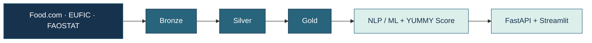

# Benoist LÉGAL

**Data Engineering · Architecture · IA**

**3 ans d'expérience à l'INA** · **Master Ingénierie de la Donnée — Mines Paris – PSL**

## 👋 En quelques mots

Je travaille à la rencontre des **besoins métiers, des systèmes existants et de l'ingénierie data** : analyser les flux, concevoir des architectures, fiabiliser les traitements et accompagner leur industrialisation.

Après **trois années à l'Institut national de l'audiovisuel (INA)**, je souhaite contribuer à de nouveaux projets **Data & IA**, tout en développant mon expertise en **Cloud et IA générative**.

## 💼 Ce que j'ai réalisé à l'INA

| Architecture & industrialisation | Data, NLP & qualité |
| :--- | :--- |
| **4 produits Data & IA** : cartographie, flux, DAT/DDEX, préparation de l'industrialisation | Pipeline **Python / BERT** : enrichissement de données d'entraînement par *hard negatives* |
| Migration d'infrastructure : analyse des dépendances, préparation de la bascule et runbook | Référentiels et Datamarts : qualification d'entités, cohérence et complétude |
| Accompagnement d'un outil de qualification de personnalités, du PoC à la production | Tests de non-régression automatisés : **plus de 50 % de temps de recette économisé** |

<b>En savoir plus sur mon expérience INA</b>

Chargé de projets Data (2023–2026), Direction de la Technologie — Ingénierie transverse. Travail avec les équipes métiers et techniques sur l'analyse de l'existant, la documentation d'architecture, les référentiels et l'industrialisation de solutions Data & IA. Les données et systèmes internes ne sont pas publiés ici.

## 🍽️ YUMMY — Mon projet Data & IA

**[Explorer le code et l'architecture de YUMMY →](https://github.com/benstL/yummy-data-platform)**

Né de mon projet de Master, **YUMMY** est une plateforme de recommandation de recettes qui rapproche **recettes, avis utilisateurs et données de saisonnalité**. Elle me permet de concevoir une chaîne data de bout en bout, jusqu'à une application de recommandations explicables.

**Stack :** `Python` `DuckDB` `Parquet` `Airflow` `dbt` `MinIO` `Docker` `FastAPI` `Streamlit` `scikit-learn`

**Aujourd'hui :** MVP avec préparation des données, scoring, API et interface. **En évolution :** observabilité, industrialisation, explicabilité et nouvelles fonctionnalités IA. Les briques expérimentales ne sont pas toutes utilisées dans le parcours applicatif courant.

<b>Voir les prochaines évolutions de YUMMY</b>

- Améliorer la pertinence et l'explicabilité du YUMMY Score.
- Renforcer les contrôles qualité et l'observabilité des pipelines.
- Poursuivre l'industrialisation et explorer les usages de l'IA générative.

## 🛠️ Mes outils

**Data & backend :** Python · SQL · Pandas · FastAPI · DuckDB · MongoDB · dbt  
**ML / NLP :** BERT · NER · TF-IDF · KMeans · VADER · scoring  
**Orchestration & DevOps :** Airflow · Dagster · Docker · Jenkins · GitHub Actions · Helm  
**Architecture & qualité :** Medallion · ETL/ELT · DAT/DDEX · TNR · CI/CD · runbooks

---

### Un projet data à construire ou un système à faire évoluer ?

**Échangeons !**

[LinkedIn](https://linkedin.com/in/benoistlegal) · [Email](mailto:benoistlegal@gmail.com) · [YUMMY](https://github.com/benstL/yummy-data-platform)

