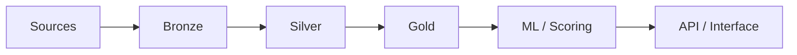

# Benoist LÉGAL

**Data Engineering · Architecture applicative · IA**

*Comprendre l'existant. Fiabiliser les données. Construire la suite.*

## 👋 En quelques mots

Diplômé d'un **Master en Ingénierie de la Donnée (Mines Paris – PSL Executive Education)**, j'ai travaillé **3 ans à l'INA** sur des projets Data & IA, à l'interface entre équipes métiers et techniques.

J'interviens de l'**analyse de l'existant** à l'**industrialisation** : architecture et flux applicatifs, pipelines de données, qualité, documentation d'exploitation et traitements NLP/ML. Je souhaite contribuer à des projets de transformation Data & IA, tout en développant mes compétences, notamment en **Cloud (notions en cours d'approfondissement)** et en IA générative.

## 🏗️ Ce que j'ai réalisé à l'INA · 2023–2026

- **Architecture de 4 produits Data & IA** : cartographie des composants et des flux, DAT/DDEX, préparation du passage du PoC à la production.
- **Qualité & industrialisation** : analyse des Datamarts, accompagnement d'une migration de service et automatisation de tests de non-régression — **plus de 50 % de temps de recette économisé**.
- **NLP & référentiels** : outil de qualification de personnalités, rapprochement d'entités et pipeline Python d'enrichissement de données d'entraînement BERT (*hard negatives*).

<b>Voir les autres contributions et méthodes</b>

- Analyse des dépendances applicatives, préparation de runbooks de migration et reprise.
- Contrôles de cohérence, complétude et anomalies des données exploitées par les métiers.
- Collaboration avec les équipes documentaires, data, qualité et exploitation.
- Documentation technique et accompagnement des évolutions des systèmes existants.

## 🍽️ Projet phare — [YUMMY](https://github.com/benstL/yummy-data-platform)

**Une plateforme Data & IA de recommandation alimentaire durable — MVP fonctionnel, en évolution.**

YUMMY transforme des données de recettes, d'avis et de saisonnalité en **recommandations explicables**. J'y explore l'ensemble de la chaîne, de l'ingestion à la restitution :

**Stack :** Python · SQL · DuckDB · Parquet · Airflow · dbt · MinIO · Docker · FastAPI · Streamlit · NLP / clustering

**Aujourd'hui :** pipeline de transformation, traitements ML/NLP, scoring multicritère, API et interface de consultation.  
**Demain :** fiabilisation du pipeline, observabilité, enrichissement des recommandations et exploration de l'IA générative.

➡️ **[Explorer le code, l'architecture et la roadmap de YUMMY](https://github.com/benstL/yummy-data-platform)**

## 🧰 Mes terrains de jeu

| Domaine | Technologies & pratiques |
|---|---|
| **Data & backend** | Python, SQL, Pandas, NumPy, FastAPI, APIs REST |
| **Architecture & stockage** | ETL/ELT, Medallion, Datamarts, DuckDB, MongoDB, Parquet, MinIO/S3 |
| **IA & NLP** | BERT, NER, TF-IDF, KMeans, VADER, clustering, scoring |
| **Industrialisation** | Airflow, Dagster, Docker, GitHub Actions, Jenkins, tests, CI/CD, DAT/DDEX |

Cloud : notions et apprentissage en cours — pas une expertise revendiquée.

---

**Un système à comprendre, des données à valoriser ou un projet à faire évoluer ?**  
[Échangeons sur LinkedIn](https://linkedin.com/in/benoistlegal) · [Découvrir YUMMY](https://github.com/benstL/yummy-data-platform)

